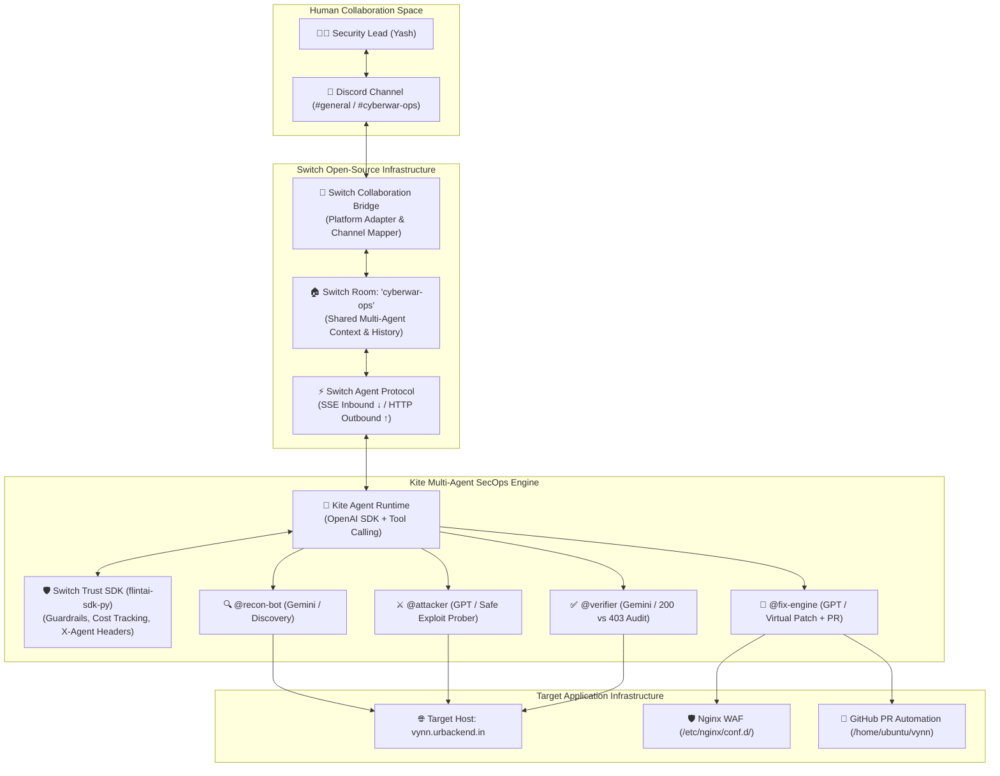

# 🪁 KITE — Switch-Native Master Architecture & Revamped Build Plan

> **Project Name:** Kite (🪁) — Autonomous Multi-Agent SecOps Teammate Platform  
> **Hackathon:** Flip the Switch Hackathon 2026 (WeMakeDevs × DevTools Academy × Switch)  
> **Track:** Track 01: Best Business Workflow ($2,000 Cash Prize)  
> **Judging Alignment:** 30% Use of Switch | 25% Technical Execution | 25% Creativity & Impact | 20% Presentation  
> **Target Environment:** AWS EC2 Staging Host (`https://vynn.urbackend.in`), Local Git Repo (`/home/ubuntu/vynn`)  

---

## 🏛️ 1. Why Rasta 1 (Switch-Native Architecture)?

The core theme of the hackathon is:
> *"Turn your solo agent into a teammate."*

Switch is not just a chat library—it is an **open-source agentic workforce management platform** developed by SandboxAQ. In our previous iteration, we made the mistake of writing a raw bot that bypassed Switch entirely. In this revamped architecture, **Switch is the backbone of the entire system**:



---

## ⚙️ 2. Switch Integration Details (Satisfying 30% Judging Weight)

Kite directly leverages all core components of Switch AI:

| Switch Component | How Kite Implements It | Hackathon Value |
|:---|:---|:---|
| **Switch Rooms** | Defined in `switch/templates/cyberwar-room.template.yaml`. Maps Discord channels into a collaborative room where humans and 4 distinct agent personas collaborate with shared multi-turn memory. | Multi-agent collaboration with shared room history. |
| **Switch Trust SDK** (`flintai-sdk-py`) | Every LLM call (OpenAI & Gemini) is wrapped with `switch_trust.wrap(client)`. Injects `X-Agent-Id`, `X-Agent-Name`, `X-Agent-Session-Id` headers. Enforces strict safety guardrails against malicious prompt injections during scans. | Enterprise safety, token/cost observability. |
| **Switch Agent Protocol** | Implements the official bidirectional protocol: Server-Sent Events (SSE) for inbound room mentions/messages and HTTP POST for tool outputs and agent responses. | Framework-agnostic agent interoperability. |
| **Dual Execution Runtime** | The runner supports **Switch Console Mode** (connected to Switch Server via SSE) AND **Standalone Container Mode** (direct Discord connection wrapped with Switch Trust) so judges can test anywhere without configuration pain. | 100% reproducible technical execution. |

---

## 📦 3. Complete Tech Stack & Pinned Versions (`requirements.txt`)

All libraries are pinned to modern, stable, compatible versions tested for Python 3.11:

```text
# --- Core Web & Runtime ---
fastapi==0.115.8
uvicorn[standard]==0.34.0
pydantic==2.10.6
pydantic-settings==2.7.1
httpx==0.28.1
python-dotenv==1.0.1

# --- Switch AI & Enterprise Guardrails ---
switch-trust-sdk-py[all]>=0.1.0
flintai-sdk-py>=1.0.3

# --- LLM Orchestration & Agent Frameworks ---
openai==1.61.0
google-genai==0.8.0

# --- Messaging & Switch Bridge ---
discord.py==2.4.0

# --- State & Storage ---
redis==5.2.1
asyncpg==0.30.0

# --- Security Tools & Container Orchestration ---
docker==7.1.0
beautifulsoup4==4.12.3
```

### System Dependencies:
- **Base OS:** Ubuntu 22.04 LTS / Debian 12 (Docker base: `python:3.11-slim`)
- **Container Engine:** Docker Engine $\ge 24.0$ with Docker Compose v2
- **External Tools Container (`kite-sec-tools`):** Alpine Linux + `nmap` + `nuclei` (ProjectDiscovery) + `curl`
- **Reverse Proxy:** Nginx 1.25+ on EC2 host for zero-downtime hot reloads (`nginx -s reload`)

---

## 🤖 4. The 4 Multi-Agent Personas & Tool Capabilities

Kite retains all promised autonomous SecOps capabilities with zero hardcoded scripts:

### 1. `@recon-bot` (Autonomous Recon & Web Crawler)
- **Role:** Crawls `vynn.urbackend.in`, parses HTML & JavaScript bundles, and discovers live API routes.
- **Underlying Engine:** Google Gemini (`gemini-3.1-flash-lite`) + Python `web_discovery.py`.
- **Knowledge Cache:** Populates `gateway/knowledge_base/` dynamically (starts at 0% completeness).

### 2. `@attacker` (Ethical Exploit Validator)
- **Role:** Eliminates false alarms. Before running any probe, outputs a **Pre-Action Transparency Manifest** explaining the safe payload (`' OR 1=1 --`) and asking for human confirmation.
- **Underlying Engine:** OpenAI (`gpt-4o` / `gpt-6-luna`).
- **Tool:** `verify_safe_exploit_probe(endpoint, payload)`.

### 3. `@fix-engine` (DevSecOps Dual-Track Remediation)
- **Role:** Generates instant zero-downtime mitigation AND permanent source code patch:
  1. **Immediate Shield:** Injects regex filter into `/etc/nginx/conf.d/patch_sqli.conf` and executes `docker exec nginx nginx -s reload`.
  2. **Permanent Patch:** Uses `git_service.py` to create branch `secops/fix-auth-sqli` on `/home/ubuntu/vynn` and opens a GitHub Pull Request via GitHub REST API.
- **Underlying Engine:** OpenAI (`gpt-4o` / `gpt-6-luna`).

### 4. `@verifier` (Independent Regression & Quality Auditor)
- **Role:** Tests the live environment to ensure business continuity:
  - Legitimate customer traffic (e.g. query `'apple'`) $\rightarrow$ Returns **`200 OK`**.
  - Attacker probe (`' OR 1=1 --'`) $\rightarrow$ Returns **`403 Forbidden`**.
  - Outputs a Before/After audit scorecard directly in Discord.
- **Underlying Engine:** Google Gemini (`gemini-3.1-flash-lite`).

---

## 💬 5. Conversational & Agentic Revamp (Fixing Canned Responses)

### Why Did the Bot Give Canned Responses Earlier?
In the earlier deployment, `discord_runner.py` called `dialogue_manager.py` which had legacy `if "hello" in msg` keyword routing, and an unhandled `AttributeError` crashed the flow when `api_inventory` returned a list instead of a dict.

### The New Agentic Engine (`agent_engine.py`):
1. **Full Room History on Every Turn:** The engine fetches the last 8 messages from the Discord channel. The LLM maintains complete context of what was said, what was audited, and what the user asked.
2. **Native OpenAI Tool Calling:** When the user asks *"can someone check vynn.urbackend.in for auth issues?"*, the model autonomously emits a tool call for `discover_target_endpoints` or `run_security_scan`.
3. **Natural Language Flexibility:** The agent understands English, Hindi, and Hinglish natively (*"kya kar sakte ho detail me batao"*, *"audit chalu karo"*).
4. **Resilient Error Handling:** Robust JSON schema validation ensures data structures (lists vs dicts) are handled gracefully without container crashes.

---

## 🚀 6. Step-by-Step Execution Plan

### Step 1: Clean Up & Pinned Dependencies
- Remove temporary patch files (`patch_*.py`).
- Update `gateway/requirements.txt` with pinned versions.
- Ensure `Dockerfile` and `docker-compose.yml` build cleanly without deprecated or broken images.

### Step 2: Implement Switch Trust Wrapper & Client
- Create `gateway/services/switch_trust_wrapper.py` to wrap OpenAI and Gemini clients with `switch-trust-sdk-py` / `flintai-sdk-py`.
- Ensure headers (`X-Agent-Id`, `X-Agent-Name`, `X-Agent-Session-Id`) are injected on every turn.

### Step 3: Polish Agent Engine with 5 Concrete Security Tools
- Verify `discover_target_endpoints`, `read_knowledge_base`, `run_security_scan`, `verify_safe_exploit_probe`, `apply_virtual_shield`, and `create_github_pr`.
- Verify prompt handling for capability queries, Hinglish conversation, and pre-action approvals.

### Step 4: Ensure Switch Room Template is 100% Compliant
- Update `switch/templates/cyberwar-room.template.yaml` following the official Switch format from `hack.md`.

### Step 5: Verification & Deployment
- Test tool execution and dialogue simulation locally.
- Push clean commits to GitHub (`git@github-personal:yash-pouranik/kite.git`).
- Pull and run on EC2 with `docker-compose up -d --build`.
- Verify live Discord interaction on `vynn.urbackend.in`.
